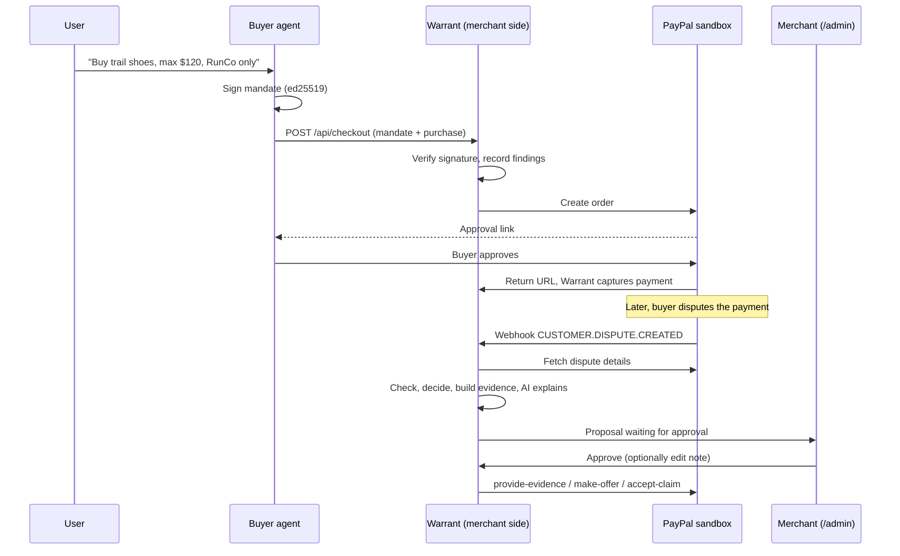

# Warrant: project overview

*Technical reference for the PayPal AI Hackathon 2026 build. Written 4 October 2026.*

## 1. What Warrant is

Warrant is dispute defense for merchants who sell to AI shopping agents. A buyer's agent presents a **signed mandate** (the user's instructions and spending limits, cryptographically signed) when it buys. If the payment is later disputed, Warrant's merchant-side pipeline:

1. looks up the order and the mandate it was bought under,
2. verifies the signature and checks the purchase against the mandate with plain code,
3. picks a response (contest, offer a partial refund, accept the claim, or hand to a human) with deterministic rules,
4. assembles an evidence pack and has an LLM explain the decision and draft the evidence note,
5. waits for the merchant to approve, then sends the response through the **PayPal Disputes API** (sandbox only).

The one design rule: **the LLM writes words; code decides; the merchant approves; only then does anything reach PayPal.**

## 2. The problem it addresses

When an AI agent buys on someone's behalf, a later "I didn't authorize this" dispute is hard to answer. The merchant has a payment record but no proof of what the user actually allowed. A signed mandate is that proof. Warrant turns it into something a merchant can use in a dispute, quickly and consistently, without trusting an LLM with money decisions.

## 3. End-to-end flow

## 4. Components and file map

| Area | Files | Role |
|---|---|---|
| Mandate | `src/mandate/types.ts, sign.ts, check.ts` | Mandate schema, ed25519 signing with canonical JSON, deterministic purchase check |
| Decisions | `src/disputes/decide.ts` | Pure function: findings in, proposed action out |
| Evidence | `src/disputes/evidencePack.ts` | Deterministic evidence summary (JSON and plain-text note) |
| Pipeline | `src/disputes/service.ts` | `processDispute` (propose), `approveDispute` (submit), `rejectDispute` |
| AI | `src/ai/draft.ts` | LLM drafting with validation and template fallback |
| PayPal | `src/paypal/client.ts, disputes.ts, webhooks.ts` | Sandbox-pinned REST client, Disputes API client, webhook verification |
| Server | `src/server/app.ts, adminPage.ts, index.ts` | Express routes, merchant approval page |
| Data | `src/db/*, src/repo.ts` | SQLite schema, migrations, small helpers |
| Demo | `src/agent/*, src/scripts/demo*.ts` | Scripted buyer agent, offline and live demos |

## 5. The mandate

A deliberately small, **AP2-inspired (not AP2-compliant)** object: id, version, user, agent, plain-English description, currency, `maxAmountCents`, `allowedMerchantIds`, optional `allowedCategories`, `validFrom`, `expiresAt`, and a nonce.

**Signing.** The mandate is serialized as canonical JSON (keys sorted recursively), hashed with SHA-256, and signed with the agent's ed25519 private key. Verification requires both that the hash matches the content and that the signature verifies against the agent's registered public key. Tampering with any field, or using a different key, fails.

**Purchase check** (`checkPurchase`, no LLM). Returns a list of findings; an empty list means the purchase is within the mandate.

| Code | Triggered when |
|---|---|
| `MANDATE_NOT_YET_VALID` / `MANDATE_EXPIRED` | Purchase time is outside the validity window |
| `MERCHANT_NOT_ALLOWED` | Merchant is not in `allowedMerchantIds` |
| `CURRENCY_MISMATCH` | Purchase currency differs from the mandate's |
| `AMOUNT_EXCEEDS_MAX` | Amount is over the limit (records the excess) |
| `CATEGORY_NOT_ALLOWED` | Mandate restricts categories and the purchase is outside them |
| `MANDATE_REVOKED` | The user revoked the mandate before the purchase |

## 6. Decision rules

`decideDisputeResponse` is a pure function. In order:

1. **Signature invalid** → `accept_claim` (authorization cannot be shown).
2. **Any blocking finding:** if the *only* problem is `AMOUNT_EXCEEDS_MAX` and the excess is less than the order amount → `offer_partial_refund` for exactly the excess. Otherwise → `accept_claim`.
3. **No blocking findings:** if the dispute reason is unauthorized (`UNAUTHORISED` / `UNAUTHORIZED`) → `contest`. For other reasons → `contest` only if delivery proof exists, otherwise `escalate_to_human`. A mandate proves authorization, not delivery.

Today `hasDeliveryProof` is always false, so non-"unauthorized" disputes are escalated.

## 7. The AI layer

**Where AI is used.** After the decision is made, an LLM (Anthropic Messages API over `fetch`; model set by `ANTHROPIC_MODEL`) writes two things: a 2-3 sentence explanation for the merchant and a factual note for PayPal's reviewer.

**What it cannot do.** It cannot change the action, trigger a submission, or see buyer-written dispute text.

**Guardrails (all in code):**
- Output must be JSON with both fields, non-empty, under length limits.
- Every number in the output must appear in the verified facts passed in. An invented amount causes rejection.
- The mandate description is third-party text: the prompt marks it as quoted data, and the admin page renders it as plain text only.
- Any failure (no key, API error, bad JSON, rule violation) falls back to a deterministic template, and the admin page labels which one you are seeing ("Explained by AI" or "Template text", with the reason on hover).
- The merchant can edit the note before it is sent.

**Honest note for the hackathon.** The requirement is that the project *meaningfully uses both PayPal and AI*. Right now AI's role is explanation and drafting, which is real but modest. Possible deepening is in section 12.

## 8. PayPal integration

| Capability | Status |
|---|---|
| OAuth token, create order, capture (`client.ts`) | Written; smoke scripts exist; **not yet run against the sandbox** |
| Webhook receiver + `verify-webhook-signature` | Written; **untested** |
| Disputes API: get, provide-evidence, make-offer, accept-claim | Written; **request bodies are unverified guesses** (evidence type `OTHER`, accept-claim reason, JSON vs multipart) |
| Creating a dispute in the sandbox | **Unknown.** Expected route is the buyer's sandbox account. Top risk to settle first |
| PayPal Agent Toolkit / MCP server | Not used yet; listed on the hackathon resources page |

The client is hard-pinned to `https://api-m.sandbox.paypal.com`; there is no production switch. Every write sends a `PayPal-Request-Id`; dispute submissions use a stable key (`warrant-<disputeId>-<action>`) so retries cannot double-submit.

## 9. Data model (SQLite via Node's built-in `node:sqlite`)

`agent_keys` (public keys of buyer agents), `mandates` (signed mandate, hash, signature, `revoked_at`), `orders` (PayPal order and capture IDs, amount, category, findings at order time), `disputes` (PayPal dispute ID, reason, proposal JSON, `workflow_state`, approved note, error), `evidence_packs`, `agent_messages` (reserved, unused), `webhook_events` (every webhook, with a `verified` flag and de-duplication by event ID).

Dispute `workflow_state`: `PROPOSED` → `APPROVED` → `SUBMITTED`, or `FAILED` (retryable) or `REJECTED`. Approval uses a conditional update, so two simultaneous approvals cannot both proceed.

## 10. Trust model and known gaps

**Defended**
- Mandate tampering or wrong key: rejected at checkout and at dispute time.
- Mandate ID reused with different content: rejected (409).
- Unverified webhooks: stored but never start work.
- Merchant routes: need `ADMIN_TOKEN` (constant-time comparison).
- XSS via mandate text: all dynamic text is set with `textContent`.
- LLM misbehavior: validated and bounded as in section 7.

**Not defended or not done**
- **Nonce replay** is not enforced (one mandate could be used for several purchases; only the amount-per-purchase is checked, not a cumulative limit).
- **Revocation** is checked but there is no endpoint for a user to revoke; only the helper `revokeMandate` exists.
- Admin token can be passed in the URL query string, which can end up in logs. Fine for a sandbox demo only.
- Webhook verification re-serializes the parsed JSON rather than forwarding the raw body; likely fine, but confirm in the sandbox.
- Amount math assumes 2-decimal currencies.
- Checkout **records but does not enforce** findings, so out-of-mandate purchases are sold and later defended. Intentional for the demo.
- On Render's free tier the filesystem is ephemeral; the SQLite file would be lost on redeploy. Use a persistent disk or move to a hosted database before relying on the deployed demo.
- A signed mandate is evidence, not a guarantee of how PayPal rules.

## 11. Status snapshot (4 October 2026)

**Built and tested (41 tests passing):** mandate signing and checks, decisions, evidence pack, dispute service (propose, approve, retry, reject, escalate, idempotency), AI validation and fallback, DB schema and migration, scripted buyer agent through the real pipeline with a fake PayPal.
**Built, exercised only in a headless browser with a fake backend:** the admin page.
**Written, never run:** the Express routes (`app.ts`), all real PayPal calls, the live demo CLI (`npm run demo`).

Caveat on "tested": the suite was run in a sandbox without `vitest`, using a small stand-in. Run `npm install && npm test && npm run typecheck` on your machine first.

## 12. Roadmap to the deadline

Submissions close **12 November 2026**. The Devpost page shows 12:00pm PST; another listing says 2:00pm PT. Plan for the earlier time and confirm in the official rules. Judging runs 13 November to 15 December; winners around 21 December.

| Week | Goal |
|---|---|
| Now to 11 Oct | Install, run tests, run `demo:offline`. Sandbox accounts and keys. Run `smoke:auth` and `smoke:order`. Settle how to raise a sandbox dispute |
| 12 to 18 Oct | Live flow end to end via `npm run demo`: checkout, capture, dispute, import, approve. Fix Disputes API request bodies |
| 19 to 25 Oct | Deploy (Render) with persistent storage, register the webhook, confirm `verified=1`. Check what the PayPal Agent Toolkit / MCP server offers |
| 26 Oct to 1 Nov | Deepen the AI role (ideas below), revocation endpoint, cumulative limits, delivery-proof input |
| 2 to 8 Nov | Polish admin page, record demo video, write Devpost submission |
| 9 to 12 Nov | Buffer. Submit at least a day early |

**Ideas to deepen AI (pick one or two, not all):** an agent that decides what supporting evidence to request from the merchant for non-"unauthorized" reasons; an LLM-assisted triage that flags suspicious mandates for human review (still advisory); use of the PayPal MCP server so the merchant agent can look up transactions through tools; an AI-generated plain-language summary of the user's original instruction for the evidence note.

## 13. Suggested 3-minute demo

1. State the problem in one sentence (agents buy; disputes follow; merchants have no proof).
2. Show the signed mandate and the checkout.
3. Raise a dispute. Show the proposal on `/admin`: the over-limit bar, the findings, the AI explanation, the editable note.
4. Approve. Show the PayPal-side result.
5. Show the contrast cases (within limit → contest; wrong category → accept) using the offline demo output if the sandbox is slow.
6. Close on the rule: the LLM never decides, and the merchant always approves.

Be upfront in the submission about scope: both agents are built by you, the mandate format is AP2-inspired not compliant, and this runs only in the sandbox. The README already says so; keep it.
