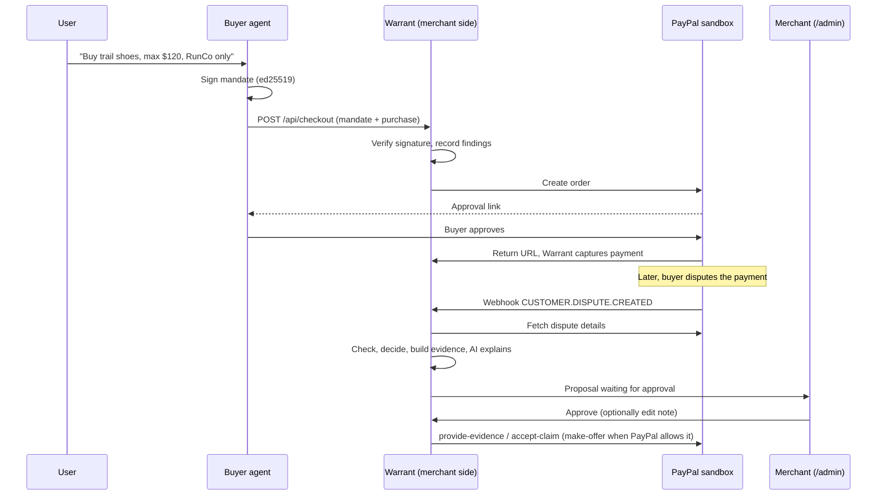

# Warrant: project overview

*Technical reference for the PayPal AI Hackathon 2026 build. Written 4 October 2026; updated 5 October 2026 after sandbox testing.*

## 1. What Warrant is

Warrant is dispute defense for merchants who sell to AI shopping agents. A buyer's agent presents a **signed mandate** (the user's instructions and spending limits, cryptographically signed) when it buys. If the payment is later disputed, Warrant's merchant-side pipeline:

1. looks up the order and the mandate it was bought under,
2. verifies the signature and checks the purchase against the mandate with plain code,
3. picks a response (contest, offer a partial refund, accept the claim, or hand to a human) with deterministic rules,
4. assembles an evidence pack and has an LLM explain the decision and draft the evidence note,
5. waits for the merchant to approve, then sends the response through the **PayPal Disputes API** (sandbox only).

The one design rule: **the LLM writes words; code decides; the merchant approves; only then does anything reach PayPal.**

## 2. The problem it addresses

When an AI agent buys on someone's behalf, a later "I didn't authorize this" dispute is hard to answer. The merchant has a payment record but no proof of what the user actually allowed. A signed mandate is that proof. Warrant turns it into something a merchant can use in a dispute, quickly and consistently, without trusting an LLM with money decisions.

## 3. End-to-end flow

**About the "Buyer approves" step.** The default demo uses a human clicking "Pay Now" in the PayPal sandbox. Warrant also supports connecting a PayPal Vault payment method; the connection and complete browser-driven no-click checkout have been verified in the sandbox.

## 4. Components and file map

| Area | Files | Role |
|---|---|---|
| Mandate | `src/mandate/types.ts, sign.ts, check.ts` | Mandate schema, ed25519 signing with canonical JSON, deterministic purchase check |
| Decisions | `src/disputes/decide.ts` | Pure function: findings in, proposed action out |
| Evidence | `src/disputes/evidencePack.ts` | Deterministic evidence summary (JSON and plain-text note) |
| Pipeline | `src/disputes/service.ts` | `processDispute` (propose), `approveDispute` (submit), `rejectDispute` |
| AI | `src/ai/draft.ts` | LLM drafting with validation and template fallback |
| PayPal | `src/paypal/client.ts, disputes.ts, webhooks.ts` | Sandbox-pinned REST client, Disputes API client, webhook verification |
| Server | `src/server/app.ts, adminPage.ts, index.ts` | Express routes, merchant approval page |
| Data | `src/db/*, src/repo.ts` | SQLite schema, migrations, small helpers |
| Demo | `src/agent/*, src/scripts/demo*.ts` | Scripted buyer agent, offline and live demos, natural-language `buy-request` |
| Integrations | `src/integrations/channel3.ts, elastic.ts, zapier.ts` | Optional sponsor adapters: product discovery, event indexing and search, proposal notifications |
| Helpers | `src/scripts/list-disputes.ts, show-dispute.ts` | List open merchant-side disputes; print one dispute with its `links` |

## 5. The mandate

A deliberately small, **AP2-inspired (not AP2-compliant)** object: id, version, user, agent, plain-English description, currency, `maxAmountCents`, `allowedMerchantIds`, optional `allowedCategories`, `validFrom`, `expiresAt`, and a nonce.

**Signing.** The mandate is serialized as canonical JSON (keys sorted recursively), hashed with SHA-256, and signed with the agent's ed25519 private key. Verification requires both that the hash matches the content and that the signature verifies against the agent's registered public key. Tampering with any field, or using a different key, fails.

**Purchase check** (`checkPurchase`, no LLM). Returns a list of findings; an empty list means the purchase is within the mandate.

| Code | Triggered when |
|---|---|
| `MANDATE_NOT_YET_VALID` / `MANDATE_EXPIRED` | Purchase time is outside the validity window |
| `MERCHANT_NOT_ALLOWED` | Merchant is not in `allowedMerchantIds` |
| `CURRENCY_MISMATCH` | Purchase currency differs from the mandate's |
| `AMOUNT_EXCEEDS_MAX` | Amount is over the limit (records the excess) |
| `CATEGORY_NOT_ALLOWED` | Mandate restricts categories and the purchase is outside them |
| `MANDATE_REVOKED` | The user revoked the mandate before the purchase |

## 6. Decision rules

`decideDisputeResponse` is a pure function. In order:

1. **Signature invalid** → `accept_claim` (authorization cannot be shown).
2. **Any blocking finding:** if the *only* problem is `AMOUNT_EXCEEDS_MAX` and the excess is less than the order amount → `offer_partial_refund` for exactly the excess. Otherwise → `accept_claim`.
3. **No blocking findings:** if the dispute reason is unauthorized (`UNAUTHORISED` / `UNAUTHORIZED`) → `contest`. For other reasons → `contest` only if delivery proof exists, otherwise `escalate_to_human`. A mandate proves authorization, not delivery.

Today `hasDeliveryProof` is always false, so non-"unauthorized" disputes are escalated.

**What PayPal will accept.** Before showing a proposal, `processDispute` checks the dispute's `links` for the action it needs (`provide_evidence`, `accept_claim`, `make_offer`). In the sandbox, an `UNAUTHORISED` dispute at the `CHARGEBACK` stage offered only `provide_evidence` and `accept_claim` (accept-claim type `REFUND` only), with no `make_offer`. So the partial-refund proposal is still produced, but it is marked as blocked: the admin page explains that PayPal does not take it at this stage, tells the merchant to refund the excess themselves in PayPal, and offers only **Dismiss**. `ENFORCE_MANDATE=true` avoids the situation by refusing out-of-mandate purchases at checkout.

## 7. The AI layer

**Where AI is used.** After the decision is made, an LLM (Gemini via `GEMINI_API_KEY`, or the Anthropic Messages API via `ANTHROPIC_API_KEY`; both over `fetch`, Gemini is used if both are set) writes two things: a 2-3 sentence explanation for the merchant and a factual note for PayPal's reviewer.

**What it cannot do.** It cannot change the action, trigger a submission, or see buyer-written dispute text.

**Guardrails (all in code):**
- Output must be JSON with both fields, non-empty, under length limits.
- Every number in the output must appear in the verified facts passed in. An invented amount causes rejection.
- The mandate description is third-party text: the prompt marks it as quoted data, and the admin page renders it as plain text only.
- Any failure (no key, API error, bad JSON, rule violation) falls back to a deterministic template, and the admin page labels which one you are seeing ("Explained by AI" or "Template text", with the reason on hover).
- The exact identifiers PayPal's reviewer needs (mandate ID, sha256 hash, signature result, and the buyer's instruction in their own words) are put at the top of the evidence note by code, never written by the model. The model's paragraph follows.
- The merchant can edit the note before it is sent.

**Honest note for the hackathon.** The requirement is that the project *meaningfully uses both PayPal and AI*. Right now AI's role is explanation and drafting, which is real but modest. Possible deepening is in section 12.

## 8. PayPal integration

Verified against the sandbox on 4 October 2026:

| Capability | Status |
|---|---|
| OAuth token, create order, capture (`client.ts`) | **Works.** Orders created and captured; the order carries the mandate ID in `custom`, which PayPal echoes back on the dispute |
| Creating a dispute | **Works via the buyer account:** Unauthorized activity, with the payment selected. Reason `UNAUTHORISED`, stage `CHARGEBACK`. Buyer and merchant get **different** dispute IDs (`PP-R-...`); Warrant imports the merchant's |
| Matching a dispute to an order | **Works.** The dispute's `seller_transaction_id` equals the stored capture ID |
| `provide-evidence` | **Works** with a JSON body and `evidence_type: "OTHER"`. Case moves to `UNDER_REVIEW` |
| `accept-claim` | **Works** with `{ note, accept_claim_type: "REFUND" }` (the only type offered). Buyer refunded in full, seller fee reversed |
| `make-offer` (partial refund) | **Not offered** for this dispute type and stage. Never exercised |
| `adjudicate` (sandbox settle) | **Not offered** to the merchant account (no link; `ACTION_NOT_ALLOWED_IN_CURRENT_DISPUTE_STATE`). Cause unconfirmed |
| Webhook receiver + `verify-webhook-signature` | **Run live.** `CUSTOMER.DISPUTE.CREATED` reached `warrant-9baj.onrender.com/webhooks/paypal`, verified, and triggered `processDispute` automatically |
| PayPal Agent Toolkit / MCP server | Optional Studio integration: PayPal sandbox MCP read tools are allow-listed and approval-gated |

The client is hard-pinned to `https://api-m.sandbox.paypal.com`; there is no production switch. Every write sends a `PayPal-Request-Id`; dispute submissions use a stable key (`warrant-<disputeId>-<action>`) so retries cannot double-submit.

### Sponsor integrations (optional, off unless configured)

| Integration | What it does | Status |
|---|---|---|
| Channel3 | **Search, verification, and recommendations.** `buy-request` searches real products (`POST /v1/search`, `x-api-key`). The demo store lists the cheapest in-budget offer as its own item and keeps the retailer in the description. A checkout refused for being outside the mandate gets in-mandate alternatives from the same search | **Run live, four queries.** Real products selected across shoes, boots and earbuds; two runs show the enrichment check catching a declared category that undersold what Channel3 says was really bought |
| Elastic | Merchant agent's investigation events are indexed and searchable at `/api/agent-events/search`; past cases at `/api/precedents` | **Run live, several queries.** Reliable for exact IDs/tool names, not for natural language over event content; `/api/precedents` relevance is unverified with only one case indexed so far |
| Zapier | A `proposal_ready`/`proposal_updated`/`evidence_requested` message is sent to a Catch Hook; the Zap can POST delivery evidence back to re-run the proposal | **Run live, full loop.** A `MERCHANDISE_OR_SERVICE_NOT_RECEIVED` dispute triggered `escalate_to_human` and `evidence_requested`; the Zap posted evidence back and the proposal flipped to `contest` |
| AG Grid (Community) | Dispute queue on the approval screen (`/admin`), a real grid with sorting, filtering and selection. Pinned to major 33 from a CDN | **Fixed.** Earlier versions loaded the library but never created a grid; the queue was hand-built buttons. Verified in a browser against a stubbed grid and API; not yet against the real CDN build |
| AG Studio | Merchant analytics dashboard at `/studio` (custom Mandate gauge widget, PayPal theme, optional agent) | Production bundle builds successfully; live browser/deployment validation remains |
| Render, Postman, OpenAPI | `render.yaml`, `postman_collection.json`, `openapi.yaml` | OpenAPI/Postman definitions updated; Render deployment and generated-client validation remain |

## 9. Data model (SQLite via Node's built-in `node:sqlite`)

`user_keys` (public keys of users, which mandates must verify against), `agent_keys` (public keys of buyer agents, which carts must verify against), `mandates` (user-signed mandate, hash, signature, `revoked_at`), `orders` (PayPal order and capture IDs, amount, category, findings at order time, and the agent-signed cart; one order per cart ID), `disputes` (PayPal dispute ID, reason, proposal JSON, `workflow_state`, approved note, error), `evidence_packs`, `agent_events` (the merchant agent's investigation steps, shown in the admin page and indexed to Elastic when configured), `agent_messages` (reserved, unused), `webhook_events` (every webhook, with a `verified` flag and de-duplication by event ID).

Dispute `workflow_state`: `PROPOSED` → `APPROVED` → `SUBMITTED`, or `FAILED` (retryable) or `REJECTED`. Approval uses a conditional update, so two simultaneous approvals cannot both proceed.

## 10. Trust model and known gaps

**Defended**
- Mandate tampering or wrong key: rejected at checkout and at dispute time.
- **The agent cannot issue its own mandate.** The mandate is signed by the user's key and checked against the key registered for that `userId`; the agent signs only the cart (the concrete purchase), which carries the mandate's id and hash. A mandate signed with the agent's key, a cart signed by anyone but the registered agent, a cart for a different mandate, and a cart that does not match the purchase are all rejected (400). At dispute time the same checks run; any failure means no valid authorization, so the proposal is to accept the claim.
- A signed cart can be used for one order only (409 on replay).
- Mandate ID reused with different content: rejected (409).
- Unverified webhooks: stored but never start work.
- Merchant routes: need `ADMIN_TOKEN` (constant-time comparison).
- XSS via mandate text: all dynamic text is set with `textContent`.
- LLM misbehavior: validated and bounded as in section 7.

**Not defended or not done**
- **The user's key is only as trustworthy as its registration.** Warrant checks the mandate against the key registered for the `userId`, but registration is a merchant-admin call (`/api/users`). Nothing here proves that the key belongs to a real person; in production that binding would come from the user's wallet or an identity issuer. In the demo the user's key (`.demo-user.json`) sits on the same machine as the agent's, so the demo shows the checks, not separate custody of the keys.
- **The purchase category is declared by the agent.** When the signed cart carries a Channel3 `productId` and Channel3 is configured, Warrant now checks Channel3's own category for that product (`src/integrations/channel3.ts`) and treats a confirmed out-of-mandate category as a blocking finding. Carts without a `productId`, or categories Warrant cannot map, are still unverified.
- `/api/catalog/search` is unauthenticated and not rate limited, so anyone who can reach the server can spend the Channel3 quota. The admin page loads AG Grid from a CDN (major version pinned, not an exact version).
- Autonomous payment (`mode: "autonomous"`) charges a saved PayPal account with no click. The Vault connection and complete browser-driven checkout were run on the sandbox (`docs/04-autonomous-purchase-spike.md`). The vault token can charge any amount, so the mandate check is the only guard, and it is stored unencrypted in SQLite. The default `approve` mode still uses the click.
- **No cumulative limit.** Each purchase needs its own signed cart, but one mandate can still back several purchases, each checked only against the per-purchase maximum. The mandate `nonce` is not tracked.
- **Revocation** is checked but there is no endpoint for a user to revoke; only the helper `revokeMandate` exists.
- Admin token can be passed in the URL query string, which can end up in logs. Fine for a sandbox demo only.
- Webhook verification re-serializes the parsed JSON rather than forwarding the raw body; likely fine, but confirm in the sandbox.
- Amount math assumes 2-decimal currencies.
- By default checkout **records but does not enforce** findings, so out-of-mandate purchases are sold and later defended. Set `ENFORCE_MANDATE=true` to refuse them with a 422; this behavior is covered by the checkout suite.
- On Render's free tier the filesystem is ephemeral; the SQLite file would be lost on redeploy. Use a persistent disk or move to a hosted database before relying on the deployed demo.
- A signed mandate is evidence, not a guarantee of how PayPal rules.

## 11. Status snapshot (5 October 2026)

**Built and tested (215 tests passing):** mandate signing and checks, decisions, evidence pack, dispute service (propose, approve, retry, reject, escalate, idempotency, blocked proposals), AI validation and fallback, DB schema, scripted buyer agent through the real pipeline with a fake PayPal, sponsor adapters, analytics datasets, and Express routes.
**Run against the PayPal sandbox:** checkout and capture, dispute creation (buyer side), dispute import and matching, the contest path (evidence accepted), the accept-claim path (buyer refunded), and the discovery that partial-refund offers are not available for this dispute type. Channel3, Elastic and Zapier were each run live. The prompt-injection defense was run live against the configured LLM (`npm run smoke:prompt-injection`).
**Deployed:** Render deployment is live (`warrant-9baj.onrender.com`) with the PayPal webhook registered and verifying. A real sandbox dispute (`PP-R-VHE-10193234`) has reached it end to end: the webhook fired, `processDispute` ran with no manual import, and proposed `contest` correctly.
**Not yet run:** which webhook events fire on dispute *update*/*resolution* (only `CREATED` observed so far), and `make-offer` against a dispute that allows it.

Full results are in `docs/03-testing-and-usage.md`, part K.

## 12. Roadmap to the deadline

Submissions close **12 November 2026**. The Devpost page shows 12:00pm PST; another listing says 2:00pm PT. Plan for the earlier time and confirm in the official rules. Judging runs 13 November to 15 December; winners around 21 December.

| Week | Goal |
|---|---|
| Now to 11 Oct | **Done 4 to 5 Oct:** install, tests, `demo:offline`, sandbox keys, smoke scripts, how to raise a sandbox dispute |
| 12 to 18 Oct | **Mostly done 4 to 5 Oct** (checkout, capture, dispute, import, approve; request bodies fixed). User-signed mandate **done** (see section 10). Remaining: cumulative spend limit, tamper demo |
| 19 to 25 Oct | Deploy (Render) with persistent storage, register the webhook, confirm `verified=1`. Check what the PayPal Agent Toolkit / MCP server offers |
| 26 Oct to 1 Nov | Deepen the AI role (ideas below), revocation endpoint, cumulative limits, delivery-proof input |
| 2 to 8 Nov | Polish admin page, record demo video, write Devpost submission |
| 9 to 12 Nov | Buffer. Submit at least a day early |

**Ideas to deepen AI (pick one or two, not all):** an agent that decides what supporting evidence to request from the merchant for non-"unauthorized" reasons; an LLM-assisted triage that flags suspicious mandates for human review (still advisory); expand the PayPal MCP read context after validating the sandbox integration; an AI-generated plain-language summary of the user's original instruction for the evidence note.

## 13. Suggested 3-minute demo

1. State the problem in one sentence (agents buy; disputes follow; merchants have no proof).
2. Show the signed mandate and the checkout.
3. Raise a dispute. Show the proposal on `/admin`: the over-limit bar, the findings, the AI explanation, the editable note.
4. Approve. Show the PayPal-side result (case under review with the note; or the refund for an accept).
5. Show the contrast cases (within limit → contest; wrong category → accept). For the over-limit case, show the blocked proposal and say why: PayPal offers only a full refund at this stage, so Warrant tells the merchant instead of sending something that would fail. Use the offline demo output if the sandbox is slow.
6. Close on the rule: the LLM never decides, and the merchant always approves.